<blockquote style="border-left: 4px solid hsl(var(--primary)); background-color: hsl(var(--primary) / 0.08); padding: 12px 16px; margin: 16px 0;">
  去见世界，也去见自己。——简练·克制向
</blockquote>

相较于上个月暑假回家休息，本月经历了很多有意思的事情，也发生了许多变化。距离上次月记已经过去了许久。最近，不知道为何总是提不起兴趣来总结上个月，或许是焦虑，想得太多；又或许是不愿意就这样结束旅程，面对之后的挑战。下文或许会给出答案。

## 开学季

9 月，学校迎来了新的血液。看着新生们不同于大学生的自信与希冀的眼神，仿佛看到了当时满怀一腔热血的自己，决定在此大展身手，以此弥补高考的遗憾。如今回顾过去，笔者不认为自己做得很成功，这都是自己一系列选择的结果。可以说是选择吧，但回头看，没有见到无数的可能，看到的只有一条既定之路。

经过两年，也是到了大三了。暑假收假回到学校这几天，不知道为什么觉得有些伤感。再之后，依旧是上课、吃饭、睡觉，一天天循环，一晃 8 天很快就过去了。两年的在校学习经历，早已让我习惯了老师的日常操作：落后的 PPT、各种点名签到的考勤，同时应对方法也愈发熟练。但愈是这样，便愈发迷茫：这样的课程，又有什么意义呢？前路在哪里？在这个选择的节点上，有人选择考研、考公，有人选择就业，去实习、找工作，也有人选择逃避，沉迷于自己的世界。可我在这大势浪潮中，又该何去何从呢？

## 上海行

开学日常上课一个多星期后，就到了无人机系统应用大赛的比赛时间。该赛事由青少年无人机赛与兵器部联合主办，比赛地点在上海东方绿洲。我们参加的是空地协同运输赛。参加比赛除了报名，还需要录制一段比赛视频并上传。暑假完成电赛后，我们按照要求完成了录制，后面顺利通过检查，获得了参赛资格。于是，9 号那天我们收拾好行李，提前买好票，坐动车出发了。少年握紧拳头，看向前方，似乎暗自做了一个决定。

出发之前，我们去零食店买了些小零食在车上吃。动车上，一边吃零食，一边看着动漫《记忆管理局》（之前很想看，却没有时间看，今天终于看上了），一口气直接看完 7 集。看完后久久不能回神，细细品味，绝对是神作啊：完美的意识流、完美的建模画面，再搭配上非常契合的音乐，那种感觉一下就上来了。

忘了也没关系……燃烧的秸秆……空洞……魂兮归来啊啊。时间一滴滴落下，开出一颗一颗烟花，用记忆写下此刻的伟大。时间枪可以送他回到那里，可我已经回不去了。下车之后，久久仍不能释怀。但现在看来，当时或许想通了一些事情，内心已经得出了一些答案。动车上一次丰富的精神经历，开启了我们的上海之旅。

很快就到了上海虹桥站，再坐 1 个多小时的地铁，就到了比赛附近的酒店——汉庭酒店。收拾好行李后，已经 21 点多了。趁着还不是很晚，我们打算出去觅食。呆惯了小城市，第一次来到大城市，还是有些稀奇的。我们路上谈论着这里和其他城市的不同，后来找了一家火锅店，饱餐一顿后回去美美睡了一觉。

第二天是看场地的时间。在酒店吃完早餐后，我们一大早就打车来到了东方绿洲。进去之后一路上走走停停、拍拍拍，大伙都很兴奋。看到比赛场地后，我们商量好第二天的对策和分工，继续看其他有趣的东西。确实难得大家能一起出来一次，下次人这么齐不知道是什么时候了，或许可能是永远了吧，希望这一刻能够定格于此。

于是我们把整个园区逛了一遍后，想出去玩的心仍然蠢蠢欲动。大家也有点饿了，于是出去吃饭，下午和晚上就在外面玩了。先后去了武康大楼、外滩和陆家嘴。

武康大楼确实独特，和周围建筑风格完全不同，像一位冲锋陷阵的勇士，一剑封喉。之后前往外滩，令人烦恼的是手机电量不是很足，走到一半就没有多少电了，幸好可以租用美团充电宝，问题得到了解决。

傍晚，我们到了外滩。此刻落日余晖，黄浦江和东方明珠交相辉映。这是小时候电视台上的东方明珠啊，多么令人神往的东方明珠啊。小明从家走到东方明珠只要 20 分钟，而我却用了 20 年。此时它正直挺挺地伫立在那里，安安静静地见证一次次盛大的开放，也见证我们的到来。闲看庭前花开花落，漫随天外云卷云舒。

之后，我们去了陆家嘴。在楼底下，能感受到高楼大厦强烈的压迫感。原来真的能有这么高的楼，它也是如此宽大。最后，我们乘坐最后一趟末班地铁回到酒店，准备第二天的比赛事宜。

很快来到了比赛当天。因为抽到了 4 号，我们一大早就起床，拿起比赛设备去比赛了。比赛过程中还是出了点小意外，并没有之前想的那么简单：比赛挂载的货物和我们之前测试的不一样，大疆带不动，飞不起来；最后好不容易飞起来，飞了一段时间，还是坠机了。

虽然心里早有预料，但不免还是有些失望。老师也过来安慰我们，说没事的，心情稍微好了很多。我们比完赛后才 9 点多，时间还长，就去看其他队伍和其他赛道的比赛了，特别是我向往的 RM 步兵。看着他们觉得很帅，很想有机会去参加，可惜我们学校没有战队。再之后，等我们学校其他队伍比完，大家一起拍了个合照，就回酒店等待结果了。

<!-- 单图改 =114px 的数字（高度，也可写 =x114）；多图改外层 --img-h 的数字。 -->

  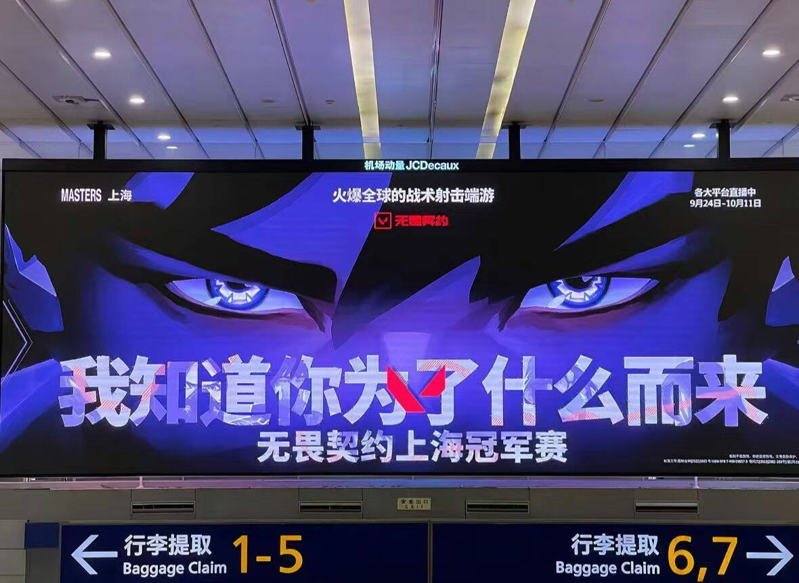
  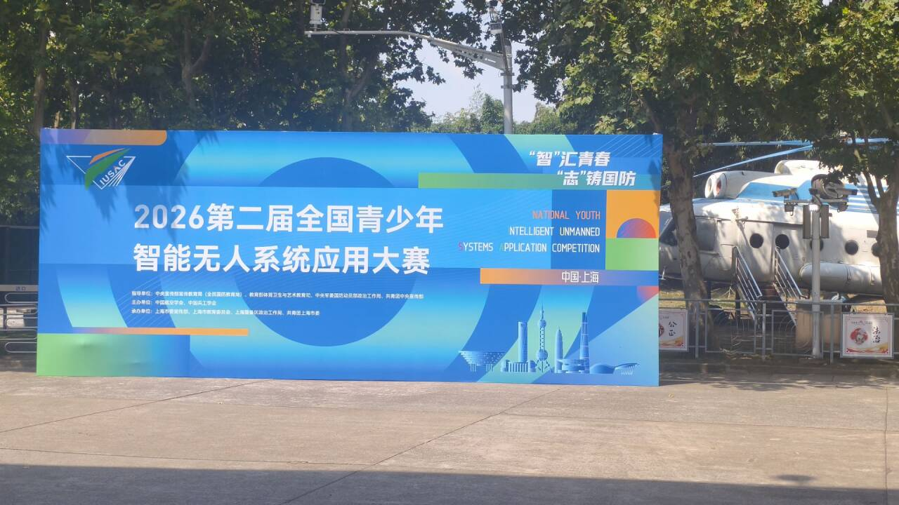
  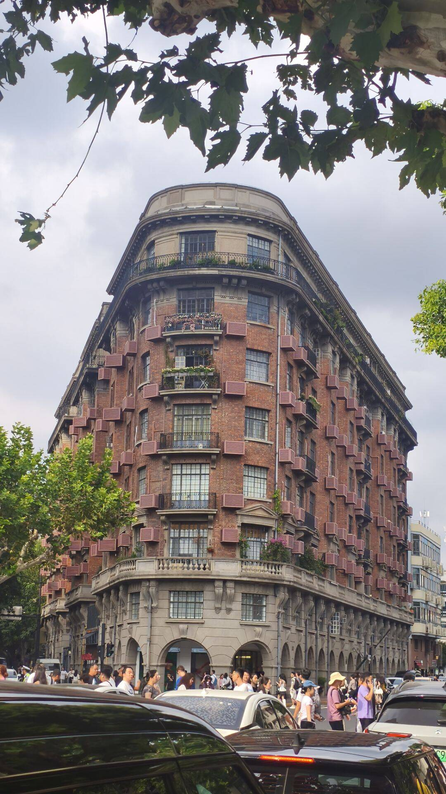
  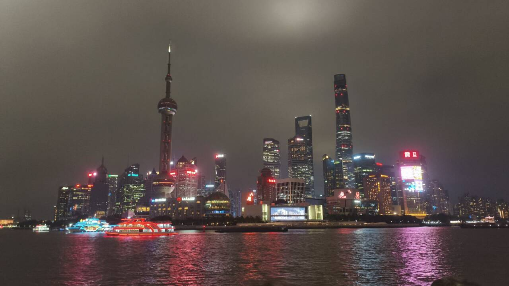
  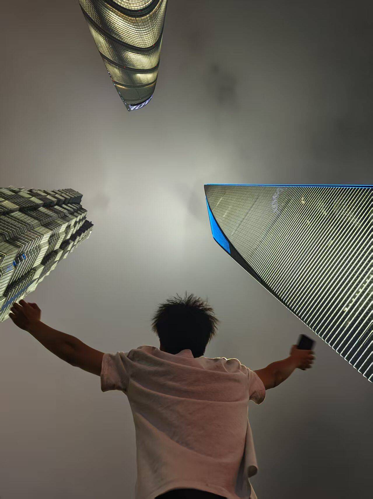

## 遗憾西塘古镇，还是苏州之旅？

接上，我们比完赛后才是中午。下午还有时间，其他人打算去附近的西塘古镇。由于我没有提前了解古镇的景点，感觉没有什么意思；还有就是需要有人提前把设备寄回去，于是我和 hzx 留在酒店，包装好设备，预约快递寄回去。

西塘啊，我就说听到这个名字怎么这么熟悉。后来查了一下才知道，是《我的26岁女房客》里的简微啊。之前看过小说，万一在那里遇到我的李小允了呢？意难平啊，西塘撒满了整个李小允的遗憾，我没去也是遗憾啊。除了这个，还有《红尘客栈》，我最爱听的歌之一。下次有机会一定要去看看，可惜了。

到了另外一天，按照计划我们打算去附近的苏州，蛮近的，60 多千米左右。做好攻略后，我们这次的路线是：虎丘 → 七里山塘 → 留园 → 寒山寺 → 夜景。

我们从酒店打车直达虎丘。下高速到苏州时，苏州给人一种和其他城市不一样的感觉：没有大城市那些繁华高楼，也没有小城市那样的复古感。或许是一种园林风吧，一种江湖气息的感觉。有人的地方就有江湖，一天在江湖，一辈子都在江湖。不由向往小说里仗剑天涯、把酒言欢、步入红尘、侠肝义胆，事了拂衣去，深藏功与名的洒脱感。

虎丘还是挺好看的，这里也是我们和小部队的汇合点。逛完大部分地方后，我们就前往下一站七里山塘。

我们的交通工具是很久没有坐过的三轮车。发动机的轰鸣声、左右摇曳的车身，还真是熟悉的感觉，上次坐过还是在上次呢。经过一路的颠簸，我们到达了七里山塘。这一条街是真的长，走了有 1 个多小时，是我走过最长的街了。但是一路上的小吃和风景也是绝佳的，吃着年糕、西瓜、奶茶和各种美食，漫步在街道中。

印象特别深刻的是苏州的手工辣条，比包装辣条好吃很多很多。他们家店可以免费品尝，嘿嘿。于是跟着人流，各种口味都品尝了一遍。后来 wsy 买了一些辣条，不然我们品尝这么多辣条都不好意思了。

山塘走完之后，我们前往留园（苏州园林之一）。江南园林甲天下，苏州园林甲江南，来到苏州当然要看一次园林了。小时候都是在语文书的课本上了解到苏州园林，来到这里，园林仿佛从语文书走到了现实。正如书上所说，每一个地方、每一个角度看过去，都是一番风景，像一幅中国画，追求画意，处处如在画中。身在园林中，给人的感觉确实和其他景区不一样，别有一番风味。

留园之后，我们出发前往寒山寺。由于距离比较近，不到 5 千米，我们一商量，打算直接骑自行车过去。说干就干，于是一行 8 人骑行在河畔。此刻，夕阳照射在水面上，波光粼粼，鸟儿欢快地在街道上飞翔，大家一起结伴而行，就这样慢慢地往前，一路上很有乐趣。这种感觉真好，感觉回到了高中的时候。

美好的时光总是短暂的，我们很快到达了寒山寺。姑苏城外寒山寺，夜半钟声到客船，小学背的古诗现在还有印象呢。一路上遇到新奇的景物就拍拍拍、打卡打卡。很快夜幕降临，我们一同去品尝了一家当地特色的苏州菜，感觉还不错。

最后选择在苏州湾欣赏夜景。那里可以看到东方之门、苏州之眼。我们伴随着音乐漫步在河畔上，有时停下来坐在台阶上，交谈着今天遇到的一些有趣的事，身心也随着放松了下来，真的很享受这样的时光。

我意外看到广场上的动图，一颗心脏正在跳动，不由想起了那一段话：万念俱灰之时，请再次振动那颗不服输的心脏。

之后我们就打算打车回酒店，运气太好了，打顺风车打到了一辆奔驰诶。

  
  
  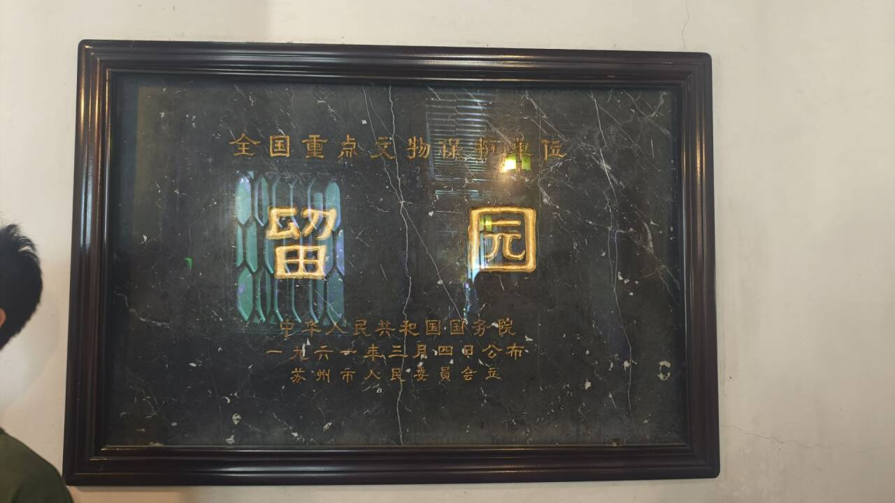
  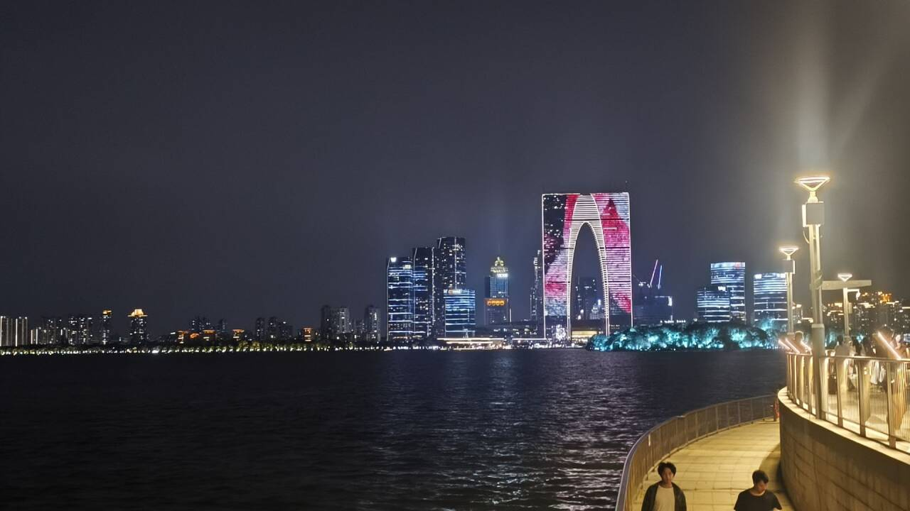
  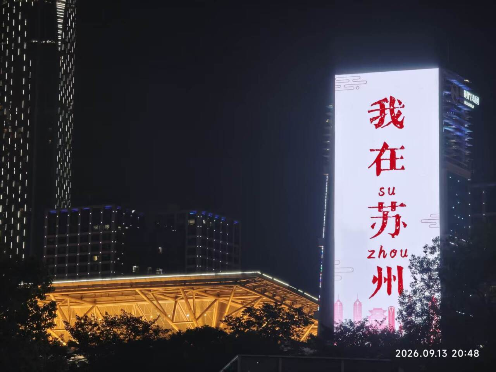
  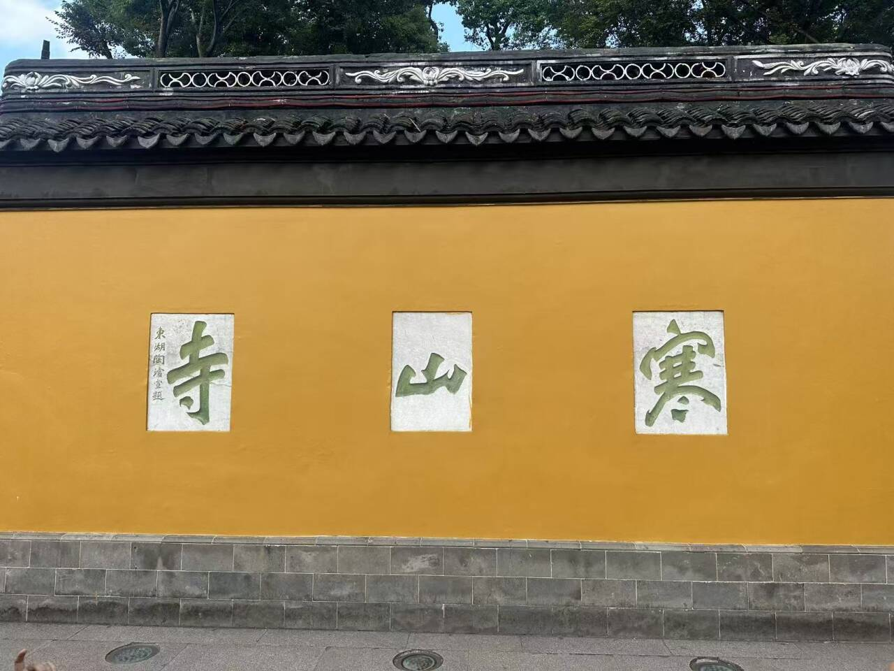
  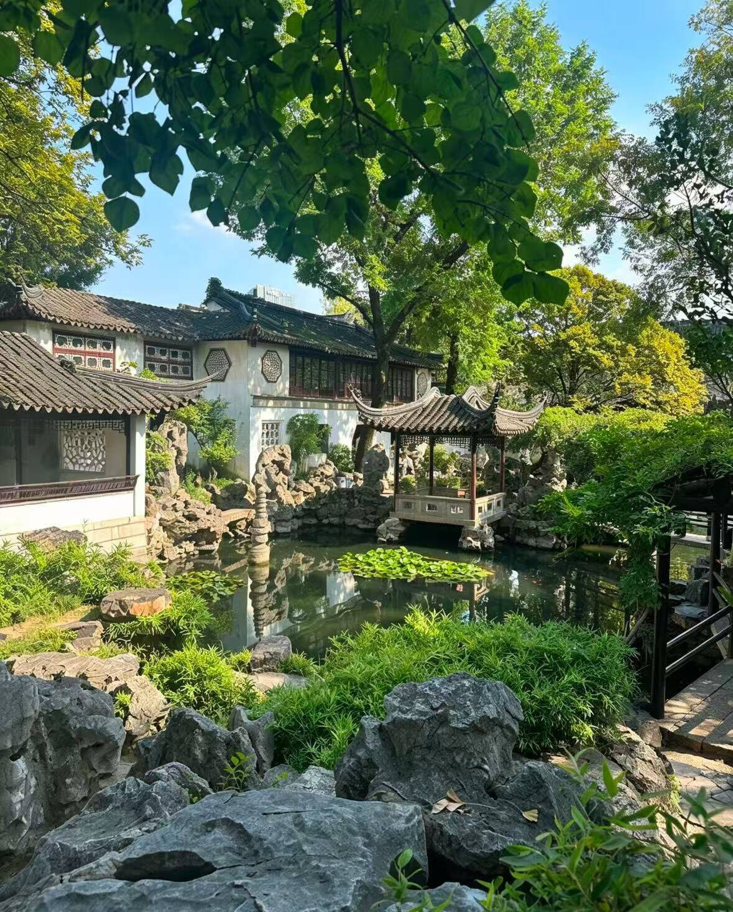
  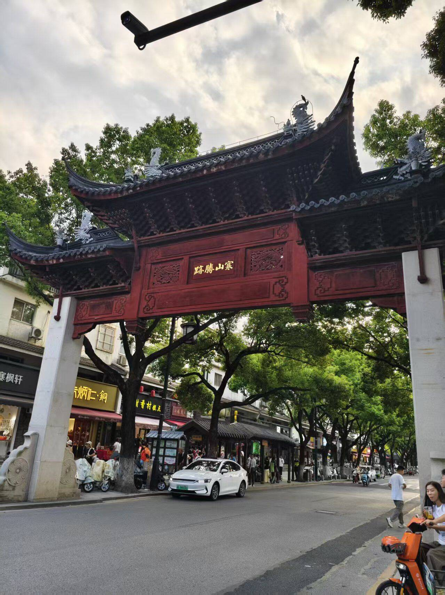

## 意外邂逅——理想生活？

接上，我们运气好，打到了一辆奔驰 C 回酒店。打电话商量时间的时候，可以听出是一位年轻男士的声音，听声音比较和蔼温柔。我们到达先前约好的地点登车，走进车内就闻到一股淡淡的清香，清润不腻。车内顶灯柔和，躺下往上看，透过天窗，还可以看到天窗上贴有星空贴纸，像是把一小片夜空裁了进来，车内仿佛就是一个小世界。

主驾和副驾前面还放置了很多可爱的手办，最显眼的是一对男女，旁边还有两个孩童的手办——可以猜出车主结婚了，还可能有两个小孩，后续询问也证明了这一点。在发动机的低鸣中，我们一路向前，其中语音导航也非常可爱：各种“消消气”、撒娇、补偿和提醒，声音也很好听，幸福着退让，安全行驶。目之所及，处处藏着细碎暖意，整台车都带着家常的幸福感。

想来车主的爱人，定是一位性情温软的女子，真羡慕啊。车主在苏州工作，住在上海，距离可能有 70 千米。长路奔波、风尘劳顿之际，时常念及身后这样一个满是烟火温情的家，满身倦意大抵也会慢慢消散吧。这真是以后向往的生活啊，何时何地我才能像车主那样，活成这般幸福美满呢。

  
  

## 第一次坐飞机

苏州之旅第二天，到了回校的日子，成绩也出来了，获得三等奖。对于炸机还能得个奖，也是有点意外，但总归有个交代吧。之前去上海的时候，一直想坐飞机去，由于没有老师陪同，只能买高铁票了。这次回学校和老师一起回校，也是如愿买上了飞机票。

我还是第一次坐飞机呢。虽然不知道为什么要提前 2 个小时到达机场，但还是服从老师的安排，事实上这是对的。到了浦东机场，是真的很大啊。还有行李托运，安检也很严格。过安检的时候，跟在人群后面，看别人做什么我就怎么做，但是履带车电池没有 3C 标识，还是被扣了下来，意料之中了。

安检进去后，就去登机区了，又走了好远才到，机场是真的大。再然后就是上飞机了，一路上都是新奇的。我和 hzx 左看看右看看，最后找到自己的位置后就坐了下来，hzx 的座位在我旁边，靠着窗，我们拿着手机拍拍拍。

人类发明飞机成功已经有 100 多年了吧，如今我还是第一次坐。面对这庞然大物，心里还是莫名有点恐慌。飞机起飞时，猛地加速，越来越快；往上起飞时，一种失重感突然袭来，心里还是有些紧张。

系好安全带，看着飞机越飞越高，上海逐渐变小，距离越来越远了。我知道，是时候做个告别了：天下没有不散的筵席。当飞机穿过云层的时候，真是太神奇了，风景也很好看。对于天空来说，飞机还是太渺小、太渺小了。想象机器能在天空中飞翔，是多么的帅啊！人类的智慧，能制造出这样一台飞机，是太不可思议了啊。脑中突然有个奇怪的想法：生怕物理学突然失效，飞机掉下来咋办，哈哈哈。

飞机进入巡航后，居然还发放了小零食和饮料呢，这也太好了诶。空姐非常热心和周到，服务还是很体贴的。

飞机降落的时候，一种失重感突然袭来。看着旁边的人都面色如常，我也假装没有表现出任何表情，但内心早已经波涛汹涌。飞机平稳落地的那一刻，我的想法是：我又活过来了。真是一次奇妙的经历，像读《格列佛游记》时看到一系列奇特而美妙的经历一样，无法形容的感觉。

  
  
  

## 展会

从上海回来几天后，老师突然说有个展会要派代表去参加，要 3 个人，每个人去一天，我义不容辞，好吧。这次展会也是比较盛大的，因为展出的设备中有几件是我们实验室的，我们才有机会去参加。

在那里还见到了航 V 的赛车和奖杯。因为是同校的，没过一会儿我们就熟络地聊了起来：他们过来了解我们的飞机和穿越机，我去了解他们的赛车结构和制作过程。我也知道他们为何能在众多高校中脱颖而出，并代表学校参加世界赛。首先是他们对赛车的热爱，还有严格的考勤管理、老师的大力支持；最重要的是，大家团结一致，都有意愿把一件事做好。不参加其他比赛，也不去其他社团，一下课就过去做，赛车才能从 0 到 1 完整地做出来。谈起这个，他们仿佛眼里都有光，滔滔不绝地向你介绍，发自内心地自豪地谈起整个团队，也是令人羡慕。

  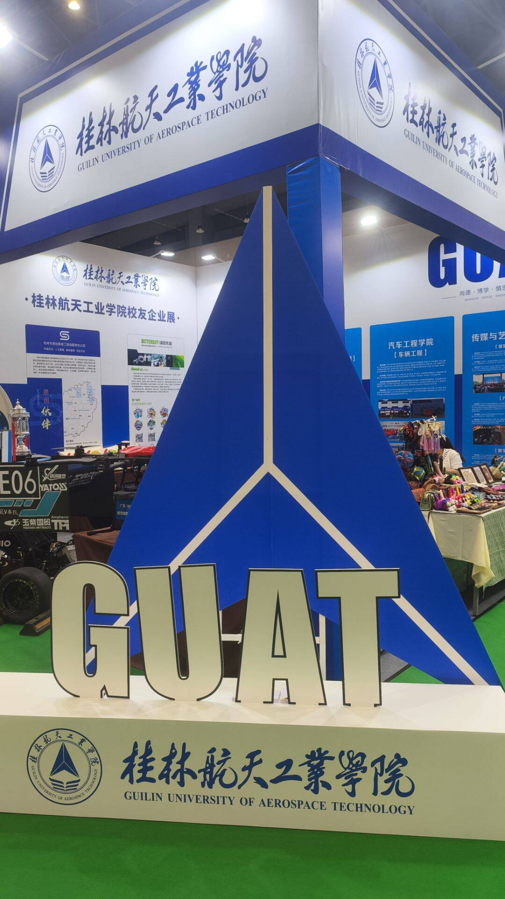
  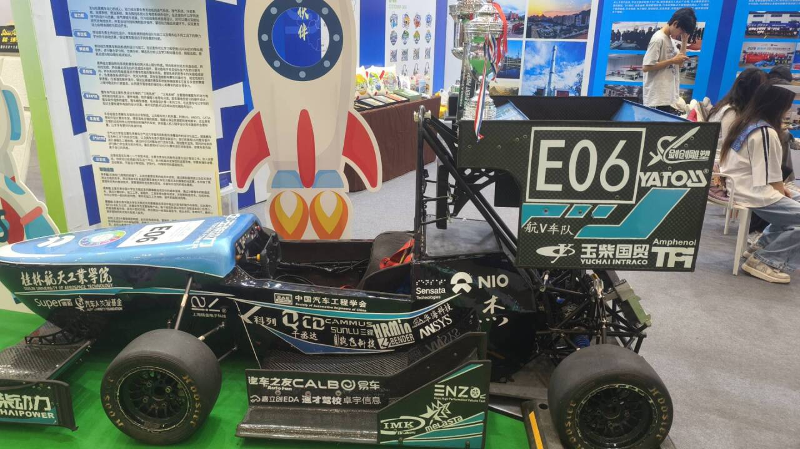

## 小结

最近，看到又在网上看到了那篇文章---[《墙角的父亲》](https://baijiahao.baidu.com/s?id=1602416158657300246&wfr=spider&for=pc)，虽然很早就看过了，但是再次看到，内心还是会有莫名的悸动。

大概故事说的是一个同学大学时很喜欢泡网吧，学校锁了门，他就翻墙出去上网，天明才回来。学习成绩自然无从提起。但是某天夜里，他和一帮朋友翻墙出去上网，翻过那堵矮墙的时候忽然看见墙下有个黑影。他像见了鬼似的立刻翻了回来，失魂落魄地回到宿舍，彻夜不眠。那天以后他仿佛变了一个人，再不沉迷上网，把所有时间都耗在图书馆里，努力得像个疯子。这很像一个鬼故事。后来那夜同去的朋友们问起他到底看到了什么，他说我看到了我爸爸。他从家乡来看我，说他住在校外的招待所里，其实那天我在墙根下看到的是他，他披着一张毯子睡着了，他要节省住宿费。

文章还是很感人，思绪纷杂。无意义如何去定于怎么样才是成功的，但至少问心无愧，做好自己想做的。我相信缓慢、平和、细水长流的力量，长期主义去坚持下来，对于我的博客有认真思考过，写这个是为什么，但我觉得写下来总是好的，随着年龄的增大，对一些事情看法渐渐有了不同，趁着自己还记得的时候写下来，时间会让记忆褪色，但文字不会。

本月的经历很多，去了蛮多地方，感触也是比较深,因此写的比较长。人终究要向前看，之后的 0854 or job是个问题。
