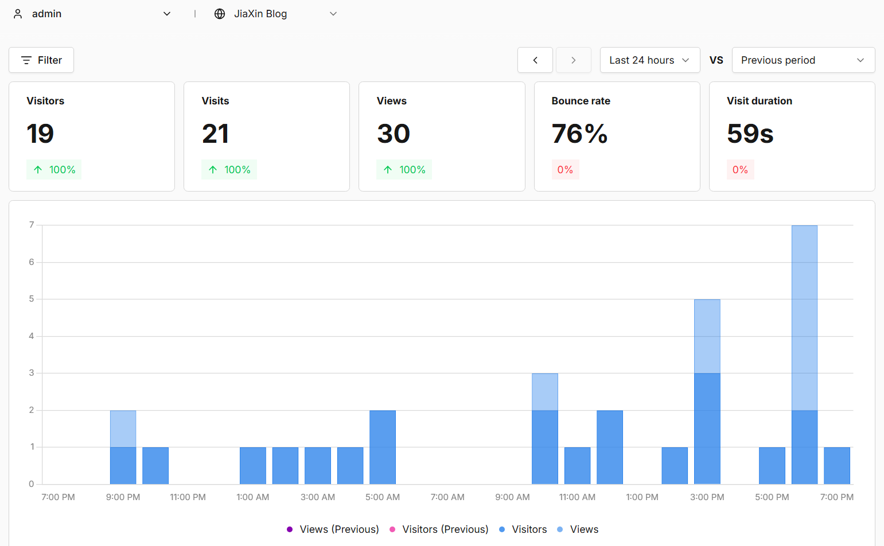

<blockquote style="border-left: 4px solid #4d6bfe; background-color: #f0f4ff; padding: 12px 16px; margin: 16px 0;">

**TL;DR** 本文记录本次搭建的技术选型和配置过程，各位可以参考。注意部署平台和 Umami 版本更新很快，涉及安装命令、连接参数和界面位置时，仍以使用版本的官方文档为准。

</blockquote>

## 前言

博客搭建已经有6个多月了，发了这么多的文章QAQ评论的确少的可怜，虽然说不影响我继续更新，但是内心还是想看看有多少人访问。
之前觉得这些统计之类的东西搭建部署应该很麻烦，要配置很多东西，但其实参考网上教程加上 AI 辅助，很快就搭建好用上了。已经把自己主要的几个网站全部加入统计，可以直观查看访客使用的浏览器、系统、设备、所在国家和历史流量曲线等等。



用到的网址：
- Umami 官网：[umami.is](https://umami.is/)
- Umami 文档：[docs.umami.is](https://docs.umami.is/)
- 官方仓库：[umami-software/umami](https://github.com/umami-software/umami)
- 我的 Fork：[JiaXinTang-xiang/my-umami](https://github.com/JiaXinTang-xiang/my-umami)
- Vercel 控制台：[vercel.com/dashboard](https://vercel.com/dashboard)
- Supabase 控制台：[supabase.com/dashboard](https://supabase.com/dashboard)

## 一、为什么选择 Umami

### Umami 是什么

Umami 是一个开源、注重隐私的网站访问分析工具，可以把它理解成一个更轻量、适合个人站和小项目的 Google Analytics 替代方案。界面比较清爽，拿来看日常访问数据很舒服。接入后，可以在后台查看页面浏览量、访客、访问来源、国家地区、设备和浏览器等数据，也能对特定按钮或操作记录自定义事件。


### 为什么是 Umami

给博客加统计系统，能选的工具其实不少。我主要想知道有多少人访问、哪些文章比较受欢迎，以及访问来源、设备、地区和浏览器的分布，不需要一开始就配复杂的埋点。相比功能繁多的分析平台，我更想要一个界面干净、数据够看，也能自己管理的数据统计系统，最后选择了 Umami。

部署好以后，在网站中加入一段统计脚本，就可以在后台查看访问趋势和各项数据。一个 Umami 实例也能管理多个网站，每个网站使用各自的 Website ID，博客和其他小项目都能放在一起查看。这些数据能帮助我了解整体访客特征，但不等于识别每个访客的真实身份，或者建立跨网站的个人画像。

#### 和不蒜子、Google Analytics 相比

| 方案 | 主要用途和特点 | 对我这次需求的适用程度 |
| --- | --- | --- |
| 不蒜子 | 接入简单，常用于在页面上展示浏览量、访客数等计数 | 如果只想在博客页脚显示访问数字就很方便；但我还想查看来源、设备、地区和历史趋势 |
| Google Analytics | 功能全面，适合广告效果、转化和复杂用户行为分析，也能与 Google 生态联动 | 能满足需求，但后台和配置需要更多学习，对我目前查看基础访问数据的用途来说偏重 |
| Umami | 开源、界面简洁，提供访问趋势、页面、来源、设备等分析，也支持自部署 | 功能覆盖当前需求，同时能自己选择部署平台和数据库，更符合我的使用习惯 |

不蒜子更适合轻量展示，Google Analytics 更适合需要深入分析和营销联动的场景。我目前需要的是方便日常查看、还能长期保存和管理数据的统计后台，因此 Umami 更符合这次的需求。

首先是**功能够用，查看直观**。页面浏览量（PV）、访客数（通常称为 UV）、热门页面和访问来源，基本覆盖了个人博客的日常需求。后台的曲线和分类统计，也比只有一个累计数字更方便观察变化。

其次是**开源并支持自部署**。部署在哪里、什么时候更新、是否迁移，以及数据库如何备份，都有自己选择的空间。使用自己管理的数据库，也方便后续导出和保留统计记录。

还有一点是**更容易控制统计范围**。基础统计不需要为了查看流量就启用一套复杂的广告追踪流程，我可以先记录必要的访问事件，再根据实际需求增加功能。

当然，自部署也意味着要自己关注更新、数据库备份和服务可用性，并不会天然比托管服务更稳定。这次使用 Vercel 和 Supabase，底层仍依赖云平台，只是 Umami 项目、数据库和迁移方式由自己管理。

#### 部署方式怎么选

确定使用 Umami 后，还要决定程序和数据库放在哪里。我整理了几种常见方式：

| 方式 | 适合的情况 | 需要关注的地方 |
| --- | --- | --- |
| Zeabur 模板部署 | 想通过现成模板快速启动应用 | 确认模板包含哪些服务，以及平台费用、持久化和备份方式 |
| Vercel + 在线数据库 | 已经使用 GitHub、Vercel，希望沿用源码自动构建的工作流 | 需要单独配置数据库，处理连接池、迁移和版本兼容；这是我本次采用的方案 |
| Docker Compose 自托管 | 已有云服务器、NAS 或家庭服务器，希望统一管理应用和数据库容器 | 需要维护主机、数据卷、网络和数据库备份 |
| 源码手动部署 | 已有 Node.js 运行环境，希望直接管理程序的构建和运行 | 需要自己安装依赖、配置进程管理、域名和 HTTPS，并处理后续升级 |

我的选择建议很简单：
- **有服务器**：优先考虑 Docker Compose，方便统一管理应用和数据库。
- **没有服务器**：可以选择 Vercel + 在线数据库，或使用 Zeabur 模板，重点确认费用和数据库配置。
- **想自己管理 Node.js 进程和构建流程**：再考虑在主机上手动部署源码。

我这次采用的是第二种：Fork 官方源码，由 Vercel 自动构建和运行，数据库放在 Supabase。它同样属于源码部署，只是不需要自己维护主机和 Node.js 进程。后续更需要关注的是服务能否长期可用，以及数据如何备份和迁移。

## 二、零成本构建方案

本来以为只是给网页加一段脚本，实际搭建时还是要先想清楚官方托管和自部署的区别，再决定运行平台、数据库和域名等等。

我看到的不少教程使用 Docker Compose。它的优点是把应用运行环境和依赖准备好，还可以用一份配置同时启动 Umami 和 PostgreSQL。对于已经有 VPS、NAS 或家庭服务器的人来说比较方便。

官方也提供 Docker 部署方式。由于我没有长期运行容器的主机，而 Vercel 不能直接运行 Docker Compose，所以这次选择从源码构建。

源码部署也是官方支持的安装方式。区别主要在于谁负责安装依赖、构建程序和运行服务：

| 对比 | Docker Compose | 源码部署到 Vercel |
| --- | --- | --- |
| 需要的运行环境 | 能运行 Docker 的主机 | Vercel 的应用构建和运行环境 |
| 安装依赖 | 通常由镜像构建过程处理 | Vercel 按仓库配置安装并构建 |
| 数据库 | 可以一并运行 PostgreSQL 容器 | 连接 Supabase 等外部数据库 |
| 更新方式 | 更新镜像并重建容器 | 更新 GitHub 源码并重新部署 |
| 维护重点 | 主机、容器、磁盘和数据库备份 | 平台配置、版本兼容、数据库连接和备份 |

之前一度把“Vercel 不能直接运行 Docker Compose”理解成“Vercel 不能部署 Umami”，这个判断不准确。**Vercel 不能直接按 Docker Compose 的方式部署，并不影响使用它支持的 Next.js 源码部署流程。** 具体构建方式仍要和所用 Umami 版本匹配。

于是我直接 Fork Umami 官方源码到自己的 GitHub 仓库。

接下来还需要数据库。之前用过 Supabase，它提供免费额度，便继续选择了它。

Supabase 和 PostgreSQL 不是两种互斥的数据库，这一点刚开始也容易混淆：PostgreSQL 是数据库系统，Supabase 则是提供托管 PostgreSQL 等功能的平台。于是选择 Supabase，就是使用它托管的 PostgreSQL，不是用一种完全不同的数据库替代 PostgreSQL。

对我来说，主要是省去自己安装数据库、维护数据库主机和处理磁盘持久化的工作。Umami 通过 PostgreSQL 连接字符串访问数据库，不需要调用 Supabase 的前端 SDK，也不需要给 Umami 配 Supabase 的公开 API Key。

于是确定了用 **GitHub 保存源码，Vercel 部署 Umami，Supabase 提供 PostgreSQL 数据库**的方案，统计服务使用自己的子域名：[analytics.jiaxin404.top](https://analytics.jiaxin404.top/)。在符合免费计划的使用条件和额度时，可以不额外购买服务器；域名费用另算，后续也要留意免费项目的暂停规则和额度变化。

使用 Vercel 运行开源 Umami、使用自己的 Supabase 项目保存数据，同样是在管理自己的 Umami 实例，只是底层服务器仍然由云平台维护。

最终结构：

```text
GitHub：my-umami 仓库
    │
    └── Vercel：Umami 独立项目
            │
            ├── 绑定 analytics.jiaxin404.top
            └── 连接 Supabase PostgreSQL

Vercel：JIABlog 博客项目
    │
    └── 访客浏览器加载 Umami 脚本
            └── 向 analytics.jiaxin404.top 发送访问事件
```

## 三、在 Supabase 创建数据库

### 1. 创建组织和项目

1. 打开 [Supabase 控制台](https://supabase.com/dashboard)，注册并登录。
2. 首次使用时先创建 **Organization**：名称自定，Type 选 **Personal**，Plan 选 **Free**；已有组织就直接使用。
3. 在组织内点击 **New project**，填写下面几项，创建后等待项目就绪。

| 项目 | 怎么填 |
| --- | --- |
| Project name | 例如 `umami` |
| Database password | 使用 **Generate a password** 生成并妥善保存，后面连接数据库要用 |
| Region | 尽量靠近 Vercel 应用实际运行的区域；我这次建在 `eu-west-1` |
| GitHub 集成 | 可以跳过，Umami 仓库由 Vercel 连接 |
| Data API | Umami 通过数据库连接字符串访问，不需要启用；自动暴露新表也无需开启 |

### 2. 复制两条数据库连接字符串

进入刚创建的**项目内部**，找到页面顶部的 **Connect**，选择 **Direct / Connection string**，Type 选 **URI**。在 **Connection Method** 中分别选择下面两种方式并复制连接字符串：

| 连接方式 | 常见端口 | 本次在 Vercel 中的用途 |
| --- | --- | --- |
| Transaction pooler（Shared pooler） | `6543` | 填入 `DATABASE_URL`，供应用运行时访问数据库 |
| Session pooler（Shared pooler） | `5432` | 填入 `DIRECT_DATABASE_URL`，供本次 Umami 版本在构建时执行数据库迁移 |

连接字符串大致如下，**实际主机名和用户名以自己项目的 Connect 页面为准**：

```ini
DATABASE_URL=postgresql://postgres.项目ID:数据库密码@你的pooler主机:6543/postgres
DIRECT_DATABASE_URL=postgresql://postgres.项目ID:数据库密码@你的pooler主机:5432/postgres
```

把复制结果中的 `[YOUR-PASSWORD]` 替换为创建项目时保存的**数据库密码**，不是 Supabase 登录密码。密码中的特殊字符需要 URL 编码，例如 `@` → `%40`、`#` → `%23`、`?` → `%3F`；只编码密码部分，保留原密码的强度。

这里记录的是我这次使用的两条连接。虽然变量名叫 `DIRECT_DATABASE_URL`，这里填的是 Session pooler 地址；是否使用这个变量，要以所部署 Umami 版本的迁移脚本为准。Connect 下方的 **Install Agent Skills** 是可选项，本次不需要安装。

## 四、Fork Umami 并导入 Vercel

### 1. Fork 官方仓库

打开 [Umami 官方仓库](https://github.com/umami-software/umami)，点击右上角 **Fork**，复制到自己的 GitHub 账号下。

### 2. 导入 Vercel

登录 [Vercel 控制台](https://vercel.com/dashboard)，点击 **Add New → Project**，导入刚才 Fork 的仓库。

如果出现 **Multiple applications detected**，选择根目录的 **app · Next.js** 作为独立项目导入。`packages/mcp` 不是这次要部署的网站服务，也不需要选择多服务部署。

| 配置项 | 本次设置 |
| --- | --- |
| Project Name | 例如 `my-umami` |
| Root Directory | 保持仓库根目录（`.`，部分界面显示 `/`） |
| Framework Preset | `Next.js` |
| Build Command | 通常沿用默认配置 |

我这次使用的 Umami 仓库已有 `vercel.json`，配置了 pnpm 安装命令。其他版本如果没有这份配置，应按该版本的要求设置包管理器，不要直接照搬旧教程里的版本号。

## 五、给 Umami 项目配置环境变量

在导入页面展开 **Environment Variables**；如果已经创建项目，进入 **Umami 项目 → Settings → Environment Variables**。添加以下三项：

| Name | Value |
| --- | --- |
| `DATABASE_URL` | 上一步复制并替换密码的 Transaction pooler 完整连接字符串（`6543`） |
| `DIRECT_DATABASE_URL` | Session pooler 完整连接字符串（`5432`），供本次版本迁移使用 |
| `APP_SECRET` | 自己生成并保存的随机字符串 |

`APP_SECRET` 可以在本机安装了 Node.js 的终端中运行下面的命令生成，复制输出即可：

```sh
node -e "console.log(require('node:crypto').randomBytes(32).toString('hex'))"
```

这三项放在 **Umami 项目**中，类型选 **Secret**，环境至少勾选 **Production**。预览部署需要连接数据库时，再按需配置 Preview 环境。

填完点击 **Deploy**，等待数据库检查、迁移和 Next.js 构建完成，部署状态变为 **Ready**。以后修改环境变量，需要到 **Deployments → Redeploy** 才会生效。不要用跳过数据库检查或迁移的方式来掩盖连接错误。

## 六、绑定自己的域名和 HTTPS

### 1. 给 Umami 项目添加域名

1. 在 Vercel 的 **Umami 项目 → Settings → Domains → Add** 中，添加自己的域名，我这里是 `analytics.jiaxin404.top`。
2. 到域名服务商处，按 Vercel 页面提示添加 DNS 记录。子域名通常使用下面的 CNAME 记录：

| 类型 | 主机记录 | 记录值 |
| --- | --- | --- |
| CNAME | `analytics` | Vercel 页面提供的目标地址 |

记录值以自己项目的页面提示为准。等待 DNS 验证和 SSL 证书签发完成后，再通过 HTTPS 打开域名。出现 **Generating SSL Certificate** 时表示证书仍在生成，可稍后刷新查看。

## 七、登录 Umami，创建博客网站

首次安装且数据库初始化正常时，默认账号通常是：

```text
用户名：admin
密码：umami
```
进入后台后，先在账户资料或用户设置里修改默认密码。
```text
Settings → Websites → Add website
```

填写网站名称和域名，域名不带协议和路径：

```text
Name：JiaXin Blog
Domain：jiaxin404.top
```
保存后，打开该网站的编辑页面，在 **Tracking code / 跟踪代码** 中找到 `data-website-id`，复制其中的值，这就是下一步要用的 **Website ID**。脚本地址应指向自己的 Umami 域名，例如 `https://analytics.jiaxin404.top/script.js`。

## 八、接入 Astro 博客

我的博客是 Astro 项目，`src/components/BaseHead.astro` 中已经预留了两项配置：

```astro
---
const umamiScriptURL = import.meta.env.PUBLIC_UMAMI_SCRIPT_URL
const umamiWebsiteID = import.meta.env.PUBLIC_UMAMI_WEBSITE_ID
---

{
  umamiScriptURL && umamiWebsiteID && (
    <script
      async
      src={umamiScriptURL}
      data-website-id={umamiWebsiteID}
      data-do-not-track='true'
    />
  )
}
```
在 Vercel 的 **博客项目 → Settings → Environment Variables** 中，为 **Production** 环境添加：

```ini
PUBLIC_UMAMI_SCRIPT_URL=https://analytics.jiaxin404.top/script.js
PUBLIC_UMAMI_WEBSITE_ID=上一步复制的Website-ID
```

这两项会写入浏览器页面，属于公开配置，类型选 **Config**。Website ID 用来标识被统计的网站，不是登录密码或管理 API 密钥。

保存后到博客项目的：

```text
Deployments → Redeploy
```

Astro 静态页面中的这些值会在构建时写入页面。只保存变量、不重新构建，已经上线的 HTML 里不会凭空多出统计脚本。如果还需要本地测试，可在项目根目录的 `.env` 中配置相同的公开变量。数据库密钥不需要放到博客项目中，`.env` 也不要提交到 GitHub。

上线后访问几篇博客文章，再到 Umami 后台查看对应网站是否收到访问记录。如果没有数据，先检查浏览器是否成功请求 `script.js` 和 `/api/send`，以及 Website ID 是否填对。这里启用了 `data-do-not-track='true'`，浏览器开启“请勿追踪”或拦截统计脚本时，测试访问可能不会被记录。

## 相关链接
- [Umami 官方安装文档](https://docs.umami.is/docs/install)
- [Umami 环境变量说明](https://docs.umami.is/docs/environment-variables)
- [Supabase PostgreSQL 连接说明](https://supabase.com/docs/guides/database/connecting-to-postgres)
- [Vercel 环境变量文档](https://vercel.com/docs/environment-variables)
- [本次参考的 Vercel + Supabase 部署文章](https://route360.dev/post/umami-supabase/)
- [我的 Umami 后台](https://analytics.jiaxin404.top/)

## 小结

自此完成了搭建。

没有服务器构建、使用 GitHub 和 Vercel 免费方案管理博客。代价是需要自己处理版本更新、连接配置和数据库维护，不能把官方托管版的省心也一并算进去。

总体来说还好。
