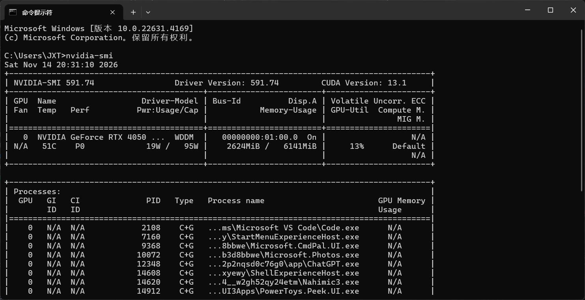
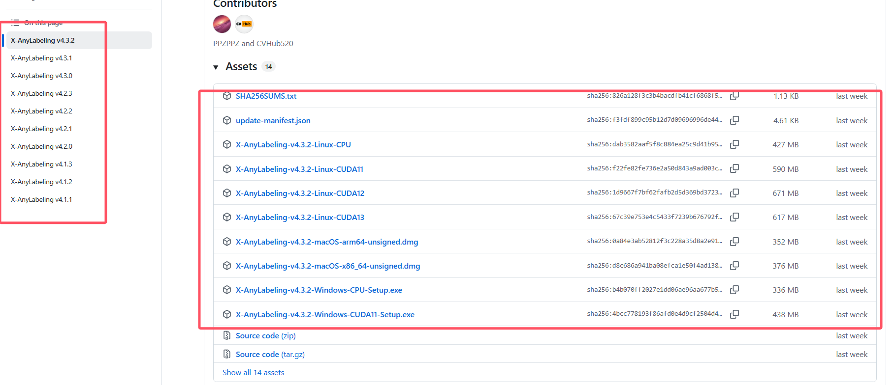
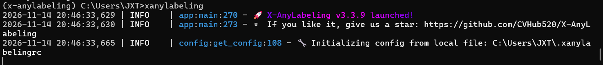
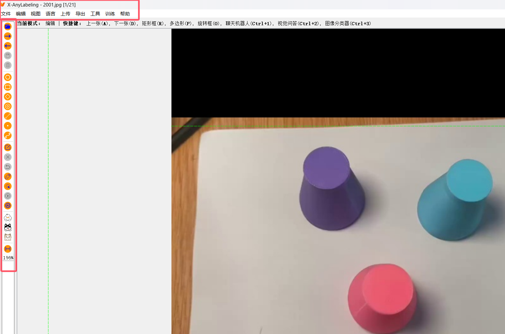
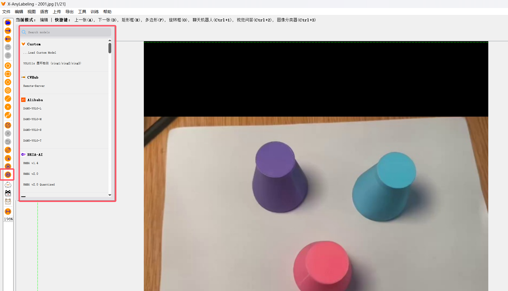

## 前言

好久之前都听说了 X-AnyLabeling 可以自动标注，一直都没啥时间，并且之前项目用到的数据集也比较少，人工标也完全够用了。

最近有时间，品尝一下 X-AnyLabeling，使用下来感觉蛮好用的。记录一下安装 **X-AnyLabeling 3.3.9 GPU 版**的过程，可以接入自己训练的 ONNX 模型进行辅助标注。

本文命令默认在 **Miniconda Prompt，也就是 CMD 风格的终端**中执行。

## 什么是 X-AnyLabeling？

X-AnyLabeling 是基于 AnyLabeling 的增强版，由社区开发者 CVHub520 维护。它集成了 YOLOv5/v8、SAM（Segment Anything Model）、Grounding DINO、RT-DETR 等主流目标检测与分割模型，支持一键自动标注，并兼容 LabelMe、YOLO、COCO、VOC 等多种标注格式。

## 一、我的环境

看看我电脑的配置

| 项目             | 配置                                     |
| ---------------- | ---------------------------------------- |
| 系统             | Windows 64 位                            |
| 显卡             | NVIDIA GeForce RTX 4050 Laptop，6GB 显存 |
| NVIDIA 驱动      | 591.74                                   |
| 环境管理         | Miniconda，新建独立环境                  |
| Python           | 3.12                                     |
| X-AnyLabeling    | 3.3.9                                    |
| ONNX Runtime GPU | 1.23.2                                   |
| NumPy            | 1.26.4                                   |
| OpenCV           | opencv-contrib-python-headless 4.10.0.84 |
| SciPy            | 1.14.1                                   |
| ONNX             | 1.17.0                                   |
| 界面库           | PyQt5 5.15.11、PyQtWebEngine 5.15.7      |

运行下面的命令可查看显卡和驱动：

```bat
nvidia-smi
```



`nvidia-smi` 显示的 CUDA Version 是驱动支持的 CUDA 版本上限，不代表当前 Python 环境要安装这个版本的 CUDA 运行库。我的电脑下的是 CUDA 12.x，不需要因为这里显示 13.1 就安装 CUDA 13。

安装方式分三种：下载可执行文件、通过 pip 安装发布包、拉取源码安装。本次最终使用 **pip 安装发布包**，不需要 Git，也不需要源码。加载自己的模型同样可以使用发布包，只有修改标注软件本身时才考虑源码安装。

已有 Conda 环境就不用再执行 `python -m venv`；两者是不同的环境管理方式，不是要连续执行的两步。

## 二、安装方式

### 方式一：直接下载可执行文件（推荐新手）

打开 [GitHub Releases](https://github.com/CVHub520/X-AnyLabeling/releases) 页面：



根据你的操作系统下载版本，解压或安装后双击运行即可，无需配置 Python 环境！

### 方式二：通过 pip 安装（本文采用）

#### 1. 下载 Miniconda

我之前安装过了，也写有教程，读者自行翻阅，或者去网上找找教程。

#### 2. 创建 Python 3.12 环境

创建时，我的电脑环境有问题就直接指定了官方源：

**方法一：指定官方源**

```bat
conda create -n x-anylabeling python=3.12 --override-channels -c https://repo.anaconda.com/pkgs/main -y
```

`--override-channels` 表示这次不使用配置文件中已有的 channels，不会修改全局软件源，也不影响原来的 YOLO 环境。

一般是下面这个，**方法二：使用已有软件源配置**。两种方法选一种即可：

```bat
conda create -n x-anylabeling python=3.12 -y
```

**创建成功之后**再激活环境：

```bat
conda activate x-anylabeling
```

确认正在使用新环境：

```bat
python --version
where python
```

Python 应显示 `3.12.x`，`where python` 的第一项应指向 `miniconda3\envs\x-anylabeling\python.exe`。如果已经创建好了这个环境，直接激活，不用重复创建。

为避免读取用户目录中其他 Python 3.12 软件包，在当前环境执行：

```bat
set PYTHONNOUSERSITE=1
conda env config vars set -n x-anylabeling PYTHONNOUSERSITE=1
```

## 三、安装 X-AnyLabeling 3.3.9 GPU 版

直接执行下面这条命令。版本组合按这次最终验证通过的环境整理：

命令中的 `--proxy http://127.0.0.1:7890` 需要本机代理已启动，并且端口为 7890；按自己的端口修改，不需要代理则删除这个参数。

```bat
python -m pip --isolated install --index-url https://pypi.org/simple --proxy http://127.0.0.1:7890 --timeout 60 --retries 2 --no-cache-dir "x-anylabeling-cvhub[gpu]==3.3.9" "onnxruntime-gpu[cuda,cudnn]==1.23.2" "numpy==1.26.4" "opencv-contrib-python-headless==4.10.0.84" "scipy==1.14.1" "onnx==1.17.0" "ml-dtypes==0.5.1" "contourpy==1.3.1"
```

几个参数的作用：

| 参数             | 作用                                                            |
| ---------------- | --------------------------------------------------------------- |
| `python -m pip`  | 使用当前环境对应的 pip                                          |
| `--isolated`     | 忽略 pip 环境变量和用户配置；它本身不会禁止 Python 加载用户级包 |
| `--index-url`    | 明确指定官方 PyPI，绕过本机原来的中科大镜像                     |
| `--proxy`        | 明确指定这次下载使用的本机代理                                  |
| `--no-cache-dir` | 不保留 pip 下载缓存，减少 C 盘占用                              |
| `[gpu]`          | 选择 X-AnyLabeling 的 GPU 依赖                                  |
| `[cuda,cudnn]`   | 将 ONNX Runtime 需要的 CUDA、cuDNN 运行库安装进当前环境         |

3.3.9 要求 NumPy 不高于 1.26.4，不能直接沿用 4.x 安装时带来的整套最新版依赖。本次同时固定 OpenCV、SciPy、ONNX、ml-dtypes 和 contourpy，避免旧版 NumPy 与新版依赖混装。

这里不需要为了标注再安装一套 PyTorch 或 Ultralytics，也不需要单独安装完整 CUDA Toolkit。训练与导出模型继续在原来的 YOLO 环境中完成，标注环境主要负责 ONNX 推理。

安装完成会显示 `Successfully installed`。如果同时出现依赖冲突，不能只看到这句话就认为环境完全正常，还要执行下一节的检查。

## 四、检查与启动

### 1. 检查依赖与版本

```bat
python -m pip check
python -c "from importlib.metadata import version; print(version('x-anylabeling-cvhub'))"
```

预期显示：

```text
No broken requirements found.
3.3.9
```

### 2. 检查 CUDA 后端

```bat
python -c "import onnxruntime as ort; ort.preload_dlls(); print('ORT:', ort.__version__); print('Providers:', ort.get_available_providers())"
```

应看到 `ORT: 1.23.2`，并且 Providers 中包含 `CUDAExecutionProvider`。

不过，这只能说明安装包包含 CUDA 后端，不能独立证明某个模型实际在 GPU 上运行。这次另外用一个禁止 CPU 回退的 ONNX 矩阵计算做了验证，CUDA 计算通过；自定义 YOLO 模型仍需加载后检查识别结果与运行日志。

### 3. 启动软件

```bat
python -c "import onnxruntime as ort; ort.preload_dlls(); from anylabeling.app import main; main()"
```

运行库装在 Python 环境中，所以先执行 `preload_dlls()`，再启动软件。普通入口 `xanylabeling` 也存在，但如果没有正确加载 GPU DLL，可能出现无法使用 GPU 的情况，本文固定用上面的启动方式。

以后打开新的 Miniconda Prompt，只需：

```bat
conda activate x-anylabeling
xanylabeling
```



或者使用前面带 GPU DLL 预加载的方式：

```bat
conda activate x-anylabeling
python -c "import onnxruntime as ort; ort.preload_dlls(); from anylabeling.app import main; main()"
```

## 五、界面介绍

| 位置     | 内容                           |
| -------- | ------------------------------ |
| 左侧     | 标注工具栏 + 模型控制面板      |
| 中间     | 图像显示区域                   |
| 右侧     | 文件浏览器（可加载图像文件夹） |
| 顶部菜单 | 文件、编辑、视图、模型、导出等 |



X-AnyLabeling 内置多个预训练模型，也可以选择自己训练的模型。



其他功能读者自行探索了。

## 六、接入自己的 YOLO11 模型

### 1. 在原来的训练环境导出 ONNX

标注软件不要求和训练程序处于同一个环境。用训练时的 Ultralytics 环境读取 `best.pt`，导出 ONNX 后交给 X-AnyLabeling 即可。

例如在 YOLO11 训练环境中，进入权重所在目录再执行：

```bat
conda activate yolov11
python -c "from ultralytics import YOLO; model = YOLO('best.pt'); print(model.names); model.export(format='onnx', imgsz=640, opset=17, dynamic=False, simplify=False)"
```

`imgsz=640` 是示例输入尺寸，应按自己的模型和实际需求调整。先核对打印出的 `model.names`，后面的配置必须使用同样的类别名称和顺序，不能只修改 YAML 就让模型识别新的类别。

导出后回到标注环境，按前面的命令启动软件。本次安装验证没有包含这份 `best.onnx` 的实际推理，导出与接入时仍需单独验证。

### 2. 准备 YAML 配置

[配置格式文件参考](https://github.com/CVHub520/X-AnyLabeling/tree/v3.3.9/anylabeling/configs/auto_labeling)：

把配置与模型放在同一个独立目录，例如：

```text
my-model/
├── best.onnx
└── yolo11s-rings.yaml
```

不必复制进 Python 的安装目录。在自动标注模型面板中使用加载自定义模型的入口，选择 `yolo11s-rings.yaml`。

下面保留这次准备的三类配置。需要修正的一点是：**3.3.9 对 YOLO11 的类型名是 `yolo11`，不是 `yolov11`**，本地官方配置和模型分发代码均使用这个名称。

```yaml
type: yolo11
name: yolo11s-rings-r20261114
provider: Ultralytics
display_name: YOLO11s
model_path: best.onnx
iou_threshold: 0.45
conf_threshold: 0.25
classes:
  - red
  - purple
  - light_blue
```

字段说明：

| 字段             | 说明                                              |
| ---------------- | ------------------------------------------------- |
| `type`           | 模型后端类型，YOLO11 检测填 `yolo11`              |
| `name`           | 自定义配置标识，多个配置之间建议保持唯一          |
| `display_name`   | 界面中显示的名称，可自行修改                      |
| `model_path`     | 模型路径；这里让 YAML 与 `best.onnx` 放在同一目录 |
| `iou_threshold`  | 检测框非极大值抑制使用的 IoU 阈值                 |
| `conf_threshold` | 置信度阈值，先用 0.25，再按实际误检、漏检调整     |
| `classes`        | 按模型 class_id 从 0 开始排列的类别名称           |

这里对应 **0=red、1=purple、2=light_blue**，仅适用于确实按此顺序训练的三类模型。`light_blue` 和 `lightblue` 是不同的标签字符串，不要在标注、训练和导出时混用。

这个三类示例独立于比赛方案里的六色物料模型、三个编号靶模型，不会改变那两套类别约定。分别接入物料与靶子模型时，应分别准备 YAML、权重与对应类别表，不能套用这里的三类名称。

## 七、自动标注实战

### 1. 导入图像

点击“打开目录”（默认快捷键 `Ctrl+U`），选择包含图片的文件夹（支持 JPG/PNG 等）。

### 2. 启动自动标注

选中一张图片，打开“Auto Labeling” 面板（默认快捷键 `Ctrl+A`），选择并加载模型后，点击运行按钮（默认快捷键 `I`）。

工具会自动运行模型，生成边界框或分割掩码，具体取决于所选模型。

### 3. 手动修正

自动标注可能有漏检或误检，可使用：

| 工具       | 用途             |
| ---------- | ---------------- |
| 矩形框工具 | 添加/修改检测框  |
| 多边形工具 | 精细调整分割轮廓 |
| 删除工具   | 移除错误标注     |

### 4. 批量自动标注（高效！）

打开图片目录并加载模型后，使用“Auto Run”（默认快捷键 `Ctrl+B`）批量处理图像。

工具会自动处理图像并保存标注结果。批量标注和格式导出是两步，处理后先检查结果，再按下一节导出 YOLO txt。

## 八、导出标注结果

X-AnyLabeling 支持以下标注格式：

| 格式       | 适用场景                            | 文件结构               |
| ---------- | ----------------------------------- | ---------------------- |
| YOLO       | 目标检测训练（Ultralytics）         | `.txt`，每张图对应一个 |
| COCO       | 通用标准（Detectron2、MMDetection） | 汇总标注 `.json` 文件  |
| Pascal VOC | 传统检测框架                        | `.xml`                 |
| LabelMe    | 默认保存的标注，支持多边形等        | `.json`                |
| Mask       | 实例分割掩码图                      | `.png`                 |

### 导出步骤

1. 保存并检查标注结果。
2. 点击顶部“导出”（Export）菜单，选择目标格式；普通矩形框选 YOLO-Hbb。
3. 按提示提供类别文件，顺序与训练时的 class_id 一致。
4. 指定保存路径，确认导出。

### 常用快捷键

以下为 3.3.9 默认快捷键，自定义配置后以软件显示为准：

| 快捷键         | 功能                             |
| -------------- | -------------------------------- |
| `Ctrl+U`       | 打开图片目录                     |
| `A` / `D`      | 上一张 / 下一张图                |
| `R` / `Ctrl+R` | 创建矩形框                       |
| `P` / `Ctrl+N` | 创建多边形                       |
| `Delete`       | 删除选中的标注                   |
| `Ctrl+Z`       | 撤销                             |
| `Ctrl+Y`       | 切换自动使用上一个标签，不是重做 |
| `Ctrl+S`       | 保存标注                         |
| `Ctrl+A`       | 打开自动标注面板                 |
| `I`            | 运行当前自动标注模型             |
| `Ctrl+B`       | 批量自动标注                     |
| `Ctrl+L`       | 切换标签显示，不是运行自动标注   |

`W` / `S` 默认用于显示/隐藏标注，`Q` / `E` 在自动标注面板中用于正/负点提示，不是切换图片。

## 参考

- [X-AnyLabeling 官方仓库](https://github.com/CVHub520/X-AnyLabeling)
- [X-AnyLabeling 官方安装文档](https://xanylabeling.com/docs/x-anylabeling/get_started)
- [3.3.9 的包版本与依赖](https://pypi.org/project/x-anylabeling-cvhub/3.3.9/)
- [3.3.9 官方 YOLO11 配置](https://github.com/CVHub520/X-AnyLabeling/blob/v3.3.9/anylabeling/configs/auto_labeling/yolo11s.yaml)
- [ONNX Runtime CUDA 后端与 DLL 加载说明](https://onnxruntime.ai/docs/execution-providers/CUDA-ExecutionProvider.html)
- [lxmyzzs 的 X-AnyLabeling 安装教程](https://blog.csdn.net/qq_42910179/article/details/155908309)：作为最初的安装路线参考，本文命令与排错记录按本机实测重新整理。

## 最后

X-AnyLabeling 相比于 labelImg 确实简化了数据标注流程，尤其适合快速构建高质量数据集，很方便。

完成。
