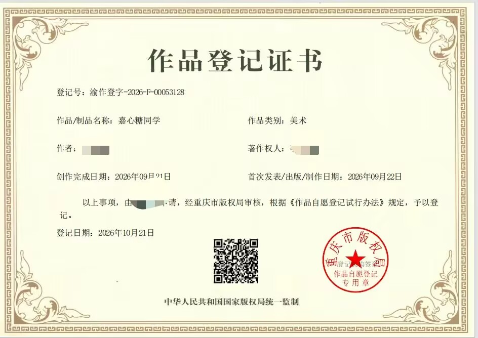

## 个人形象著作权专属声明

本站博主个人 IP 形象 **「嘉心糖同学」** 已完成作品著作权登记，由**重庆市版权局**审核登记，相关信息以作品登记证书为准。

| 登记项目 | 内容 |
| --- | --- |
| 作品名称 | 嘉心糖同学 |
| 作品类别 | 美术作品 |
| 登记号 | 渝作登字-2026-F-00053128 |
| 创作完成日期 | 2026 年 09 月 21 日 |
| 首次发表日期 | 2026 年 09 月 22 日 |
| 登记日期 | 2026 年 10 月 21 日 |

**本形象及相关美术作品不适用本站一般原创内容的 CC BY-NC-SA 4.0 授权。** 本站公开展示形象、模型和证书，不代表授予转载、改编或商业使用许可。

**保护条款：**

未经本人书面许可，除法律另有规定外：

1. 禁止转载、截取、二次绘画、修改或其他形式的二次创作。
2. 禁止盗用为个人头像、自媒体形象，或用于冒充本人、暗示本人背书。
3. 禁止任何商业使用、商业衍生及擅自向第三方转授权。
4. 本人保留对侵权行为依法取证、投诉及追究责任的权利。

### 作品登记证书公示

## 侵权处理与联系方式

本站尊重知识产权，也维护自身作品的版权权益。

- 如认为本站内容侵犯了你的合法权益，请通过[关于页面的留言区](/about/#waline)或[邮箱](mailto:2174064279@qq.com)联系，并提供相关页面链接、权属证明及具体说明。我会核实并根据情况删除、下架或更正。
- 如发现第三方盗用本站文章、图片或个人形象，也欢迎通过以上方式告知，并提供相关链接或截图。

涉及授权、转载或商业合作，请先联系本人，具体使用范围以双方书面约定为准。
